<p align="center">
  
</p>

<p align="center"><strong>라이선스 확인 · 조건 설정 · 대체재 비교</strong></p>

<p align="center">
  <a href="LICENSE"></a>
  <a href="package.json"></a>
  <a href="CHANGELOG.md"></a>
</p>

<p align="center">
  <a href="README.md">English</a> · 한국어<br>
  <a href="#데모">데모</a> · <a href="#설치">설치</a> · <a href="#플랫폼별-예시">플랫폼</a> · <a href="docs/CLI.md">CLI / MCP</a>
</p>

프로젝트의 라이브러리·자산을 검사하고 상업적 이용, 소스 공개, 허용 라이선스 조건에 맞는 대체재를 검토하는 **스킬·CLI·MCP 서버**입니다.

## 데모

**1. 라이선스와 사용 위치 확인**

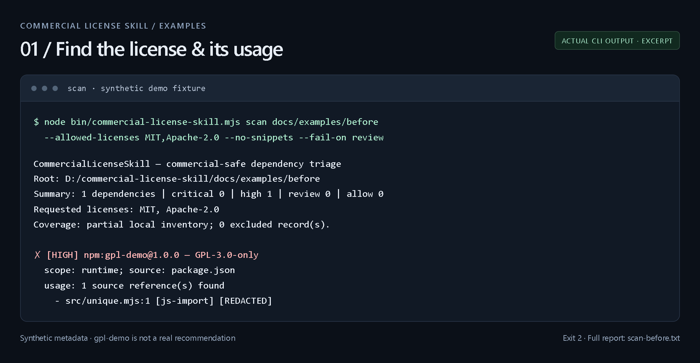

**2. 변경 전후 검토** — 중복 제거 의존성을 기본 `Set`으로 교체한 합성 예제입니다. 소스·매니페스트·잠금 파일을 수정하고 동작 4가지를 확인했습니다.

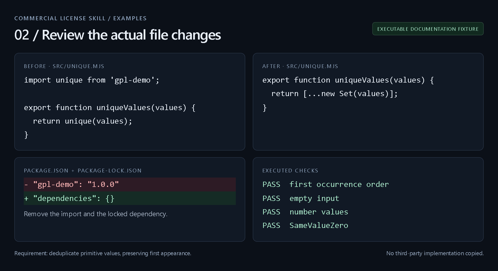

**3. 수정 후 재검사**

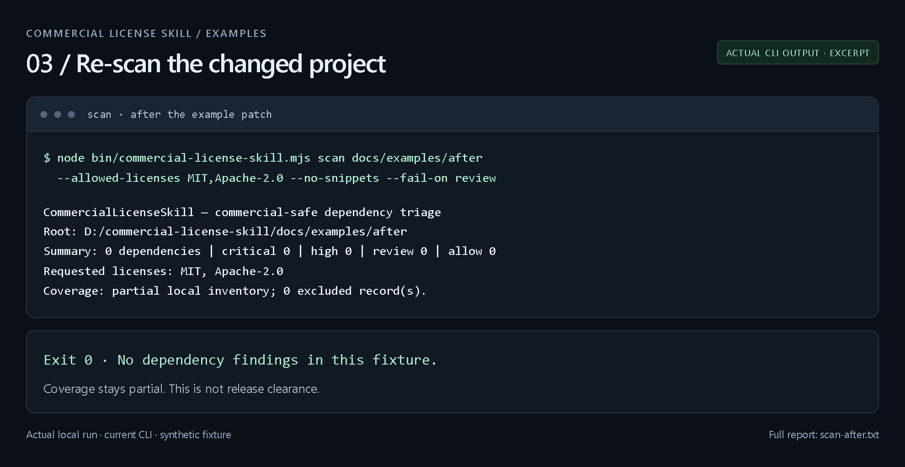

`gpl-demo`는 가상의 테스트 메타데이터입니다. 터미널 이미지는 실제 CLI 실행 결과를 발췌해 표시했습니다. [예제 파일·전체 출력·diff](docs/examples/README.md).

## 설치

미배포 0.4.0 기능은 저장소 버전으로 실행하세요.

```bash
git clone https://github.com/Aminoragit/commercial-license-skill.git
cd commercial-license-skill
npm install -g .

cd /path/to/your-project
commercial-license-skill install --project --frameworks codex,claude-code,antigravity,gemini-cli --yes
commercial-license-skill scan . --allowed-licenses MIT,Apache-2.0 --no-snippets
```

대화형 플랫폼 선택은 `commercial-license-skill install --project`로 시작합니다.

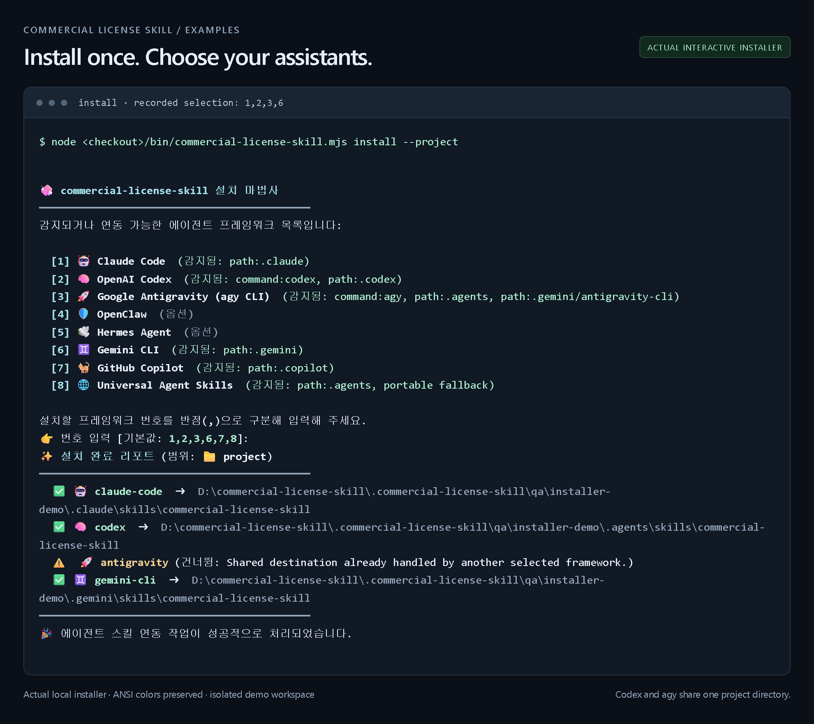

## 플랫폼별 예시

아래 그림은 **요청·패치 흐름을 설명하는 사용 예시**이며 실제 앱 캡처나 모델 실행 기록이 아닙니다. 코딩 호스트는 접근 가능한 파일을 수정하고, 채팅 전용 예시는 적용할 diff를 제안합니다. 이미지를 누르면 크게 볼 수 있습니다.

| Codex | Claude Code |
|---|---|
| [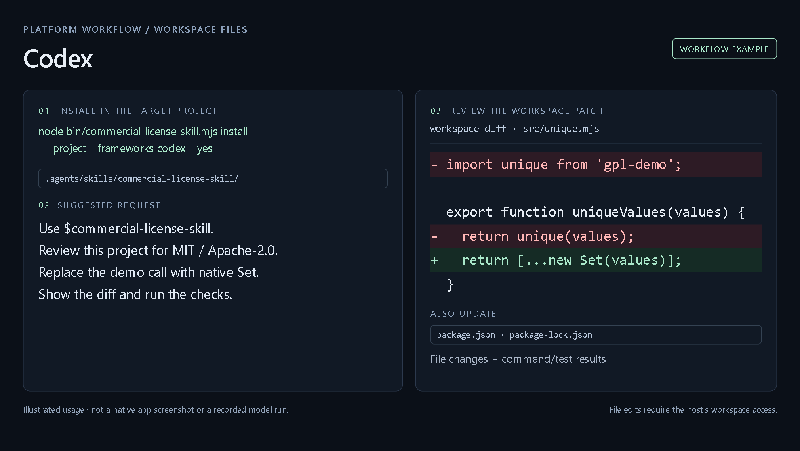](docs/assets/examples/codex.png) | [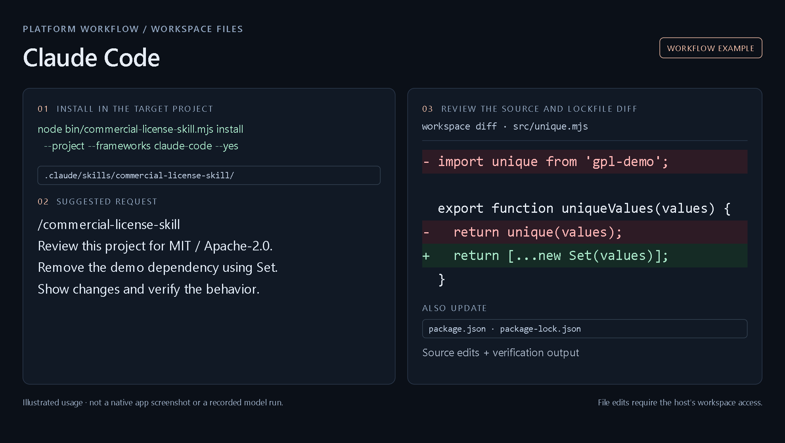](docs/assets/examples/claude-code.png) |

| Antigravity / agy CLI | Gemini CLI |
|---|---|
| [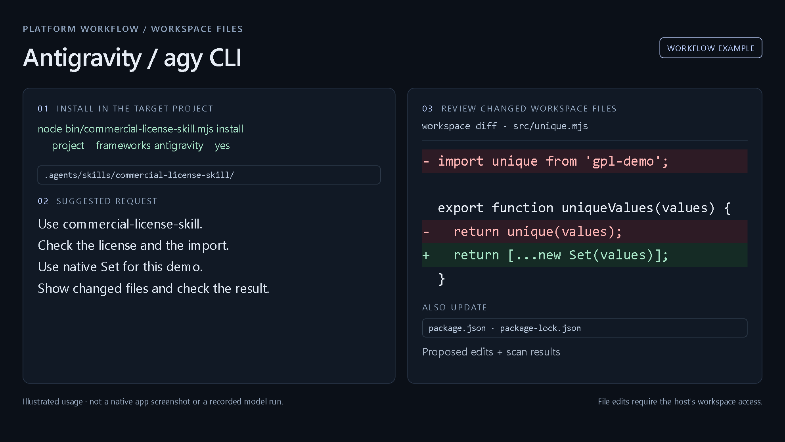](docs/assets/examples/agy.png) | [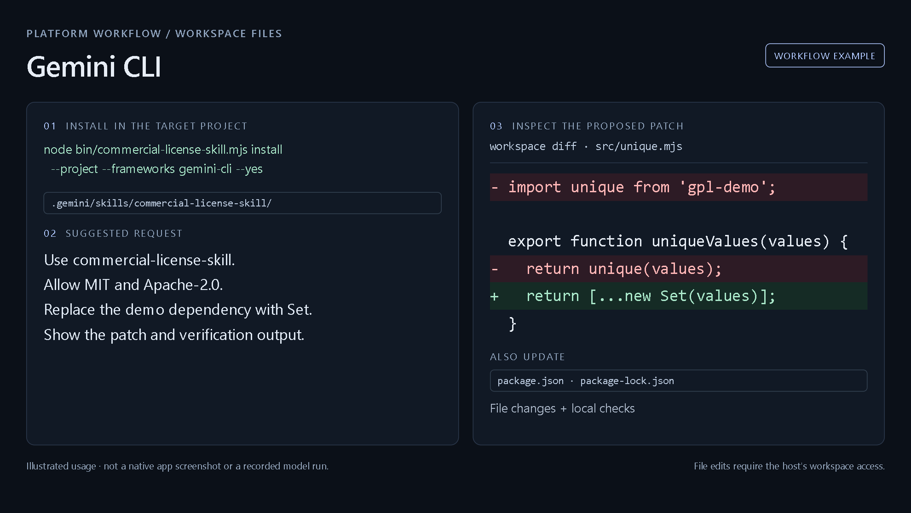](docs/assets/examples/gemini-cli.png) |

| ChatGPT | Claude |
|---|---|
| [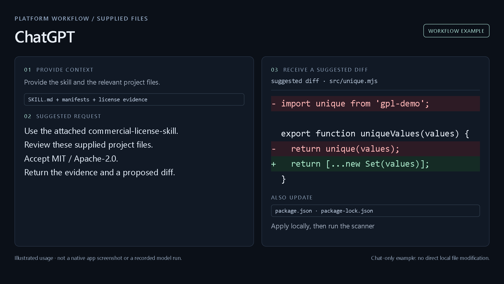](docs/assets/examples/chatgpt.png) | [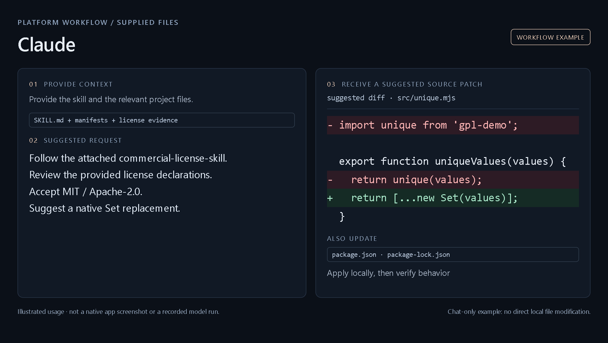](docs/assets/examples/claude.png) |

다음 요청을 복사해 사용하세요.

```text
commercial-license-skill로 이 프로젝트를 검토해줘.
MIT·Apache-2.0만 허용하고 우리 애플리케이션 소스는 비공개로 유지해야 해.
라이브러리·폰트·아이콘·번들 자산의 라이선스 근거를 확인해줘.
조건에 맞는 대체재와 실제 사용 API의 차이를 비교해줘.
선택한 대체재의 정확한 이용 조건을 확인한 뒤 패치를 준비해줘.
```

[스킬 본문](skills/commercial-license-skill/SKILL.md) · [호스트별 설치 경로·연동](skills/commercial-license-skill/references/framework-install-paths.md)

## 대체 후보 검색

```bash
commercial-license-skill recommend imagemagick --allowed-licenses MIT --json
```

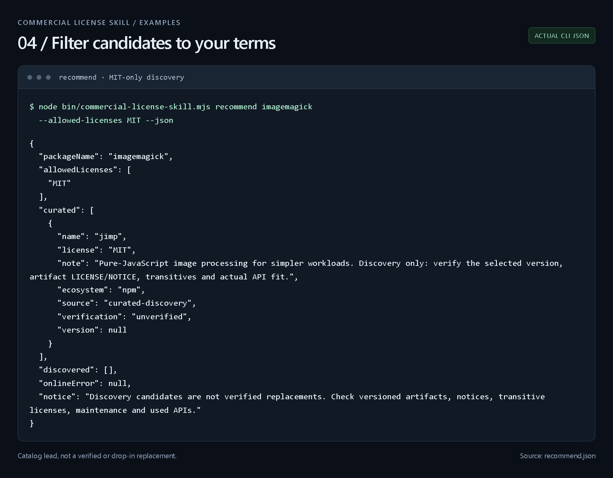

내장 목록·npm 검색은 후보 탐색입니다. 채택 전 정확한 버전의 원문, 전이·네이티브 의존성과 사용 API를 확인합니다. `--online --query "image processing"`을 추가하면 npm 검색을 사용합니다.

## Superlinked(SIE)로 질문하기

라이선스 질문을 한국어·영어로 물으면 뜻이 맞는 조항을 찾아 순위를 매겨 보여줍니다.

```bash
commercial-license-skill ask "상용 배포 가능한가?"
commercial-license-skill ask "SaaS로 제공하면 소스 공개해야 하나?" --json
```

12개 라이선스(MIT, Apache-2.0, BSD-2/3-Clause, ISC, GPL-2.0/3.0-only, LGPL-2.1/3.0-only, AGPL-3.0-only, MPL-2.0, EPL-2.0)에 대해 상용 이용·소스 공개·고지 의무 3종, 총 36개의 짧은 조항 요약을 검색합니다. Superlinked API 키가 있으면 `BAAI/bge-m3`으로 질문과 조항을 임베딩해 코사인 유사도 순으로 정렬합니다. 키가 없으면 로컬 키워드 검색으로 동작하고, 출력에 그렇게 표시합니다. 생성 모델은 쓰지 않으며, 답은 라이선스 식별자·점수와 함께 조항 요약으로만 나옵니다.

키는 환경변수로만 넣어주세요. 저장소에 키를 올리지 마세요.

```bash
export SUPERLINKED_API_KEY="..."   # 또는 SIE_API_KEY
```

2026-11-09 실측 검증: SIE 모델 목록은 110개로 `BAAI/bge-m3`와 `Qwen/Qwen3-Reranker-0.6B`가 모두 있습니다. 짧은 문장 2개를 임베딩하면 1024차원 벡터가 돌아오고 1크레딧이 들었습니다. `ask`를 SIE 모드로 직접 실행하면 `mode: sie`로 답이 오고 `AGPL-3.0-only`가 최상위로 나왔으며, 질문 + 조항 36개를 한 번에 보낸 호출(1547토큰)은 6크레딧이 들었습니다. 키가 없으면 로컬 모드로 동작합니다.

비용 가드레일: 질문 + 조항 36개를 한 번의 임베딩 호출로 묶어 보내고, 상위 5개만 보여주며, 생성 모델은 쓰지 않습니다. `ask` 한 번에 드는 비용은 몇 크레딧 수준이라, $520 런치 크레딧으로 개발·데모에 충분합니다.

조항 내용은 요약이며 법적 조언이 아닙니다. 실제 판단 전에는 라이선스 원문을 직접 확인하세요.

## 검사 범위

| 로컬 CLI | 에이전트 후속 조사 |
|---|---|
| npm 매니페스트·v2/v3 잠금 파일, 로컬 Python 메타데이터, Cargo/Go 목록, vendor 라이선스 파일·실행 명령 신호 | 정확한 이용 허락, 폰트·아이콘·이미지, 모델·가중치·데이터셋, 미지원 잠금 파일, 최종 배포물·대체재 호환성 |

> GPL·AGPL도 상업적 이용을 허용할 수 있습니다. 소스 공개 의무는 실제 이용 허락과 사용 방식에 따라 검토해야 합니다. 스캔은 부분 검사이며 `allow`가 법적 적합성을 보장하지 않습니다.

[CLI 옵션·CI](docs/CLI.md) · [MCP 연결](docs/MCP_SETUP.ko.md) · [보안](SECURITY.md) · [기여](docs/CONTRIBUTING.md) · [검토 기록](docs/REVIEW.md) · [Apache-2.0](LICENSE)
