<p align="center">
  
</p>

<p align="center"><strong>Identify licenses. Set your conditions. Compare replacements.</strong></p>

<p align="center">
  <a href="LICENSE"></a>
  <a href="package.json"></a>
  <a href="CHANGELOG.md"></a>
</p>

<p align="center">
  English · <a href="README.ko.md">한국어</a><br>
  <a href="#demo">Demo</a> · <a href="#install">Install</a> · <a href="#platform-examples">Platforms</a> · <a href="docs/CLI.md">CLI / MCP</a>
</p>

A portable skill, CLI and MCP server for reviewing dependencies and assets against your commercial-use, source-sharing and accepted-license requirements.

## Demo

**1. Find the license and its usage.**

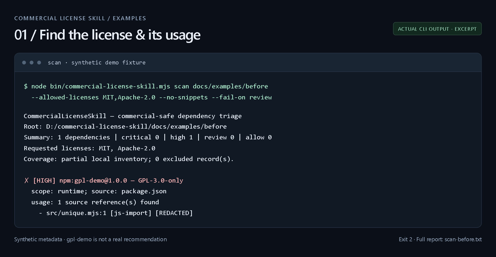

**2. Review the patch.** This synthetic example replaces a deduplication dependency with native `Set`, updates the manifest and lockfile, and checks four behaviors.

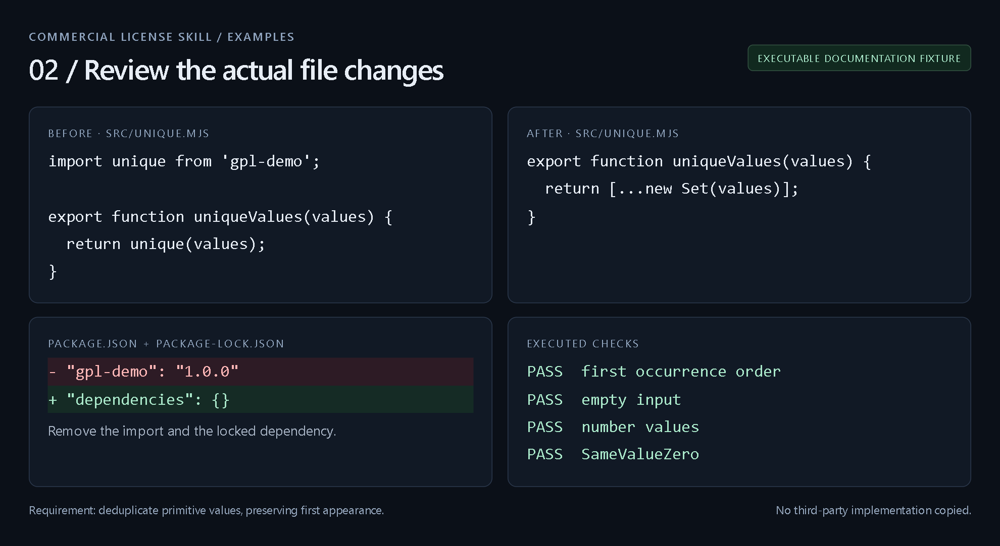

**3. Re-scan.**

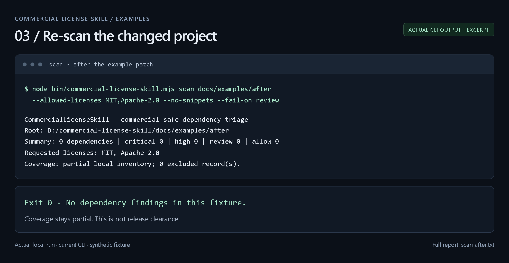

`gpl-demo` is fictional test metadata. Output images are rendered excerpts from actual CLI runs. [Files, full output and diff](docs/examples/README.md).

## Install

Use the checkout for the unreleased 0.4.0 features:

```bash
git clone https://github.com/Aminoragit/commercial-license-skill.git
cd commercial-license-skill
npm install -g .

cd /path/to/your-project
commercial-license-skill install --project --frameworks codex,claude-code,antigravity,gemini-cli --yes
commercial-license-skill scan . --allowed-licenses MIT,Apache-2.0 --no-snippets
```

For an interactive platform picker, run `commercial-license-skill install --project`:

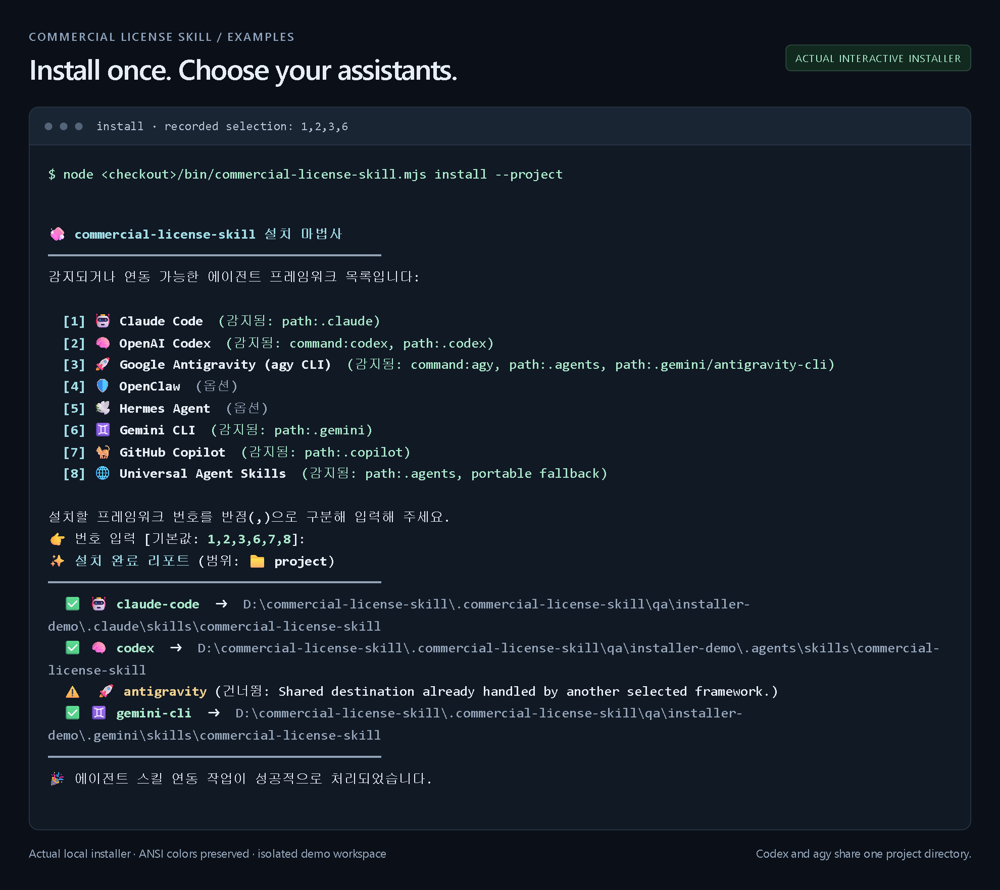

## Platform examples

These cards show **suggested requests and patch workflows**, not native app screenshots or recorded model sessions. Coding hosts can edit accessible workspace files; chat-only examples return a suggested diff. Click an image to enlarge it.

| Codex | Claude Code |
|---|---|
| [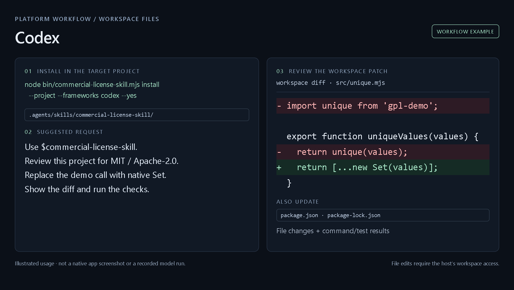](docs/assets/examples/codex.png) | [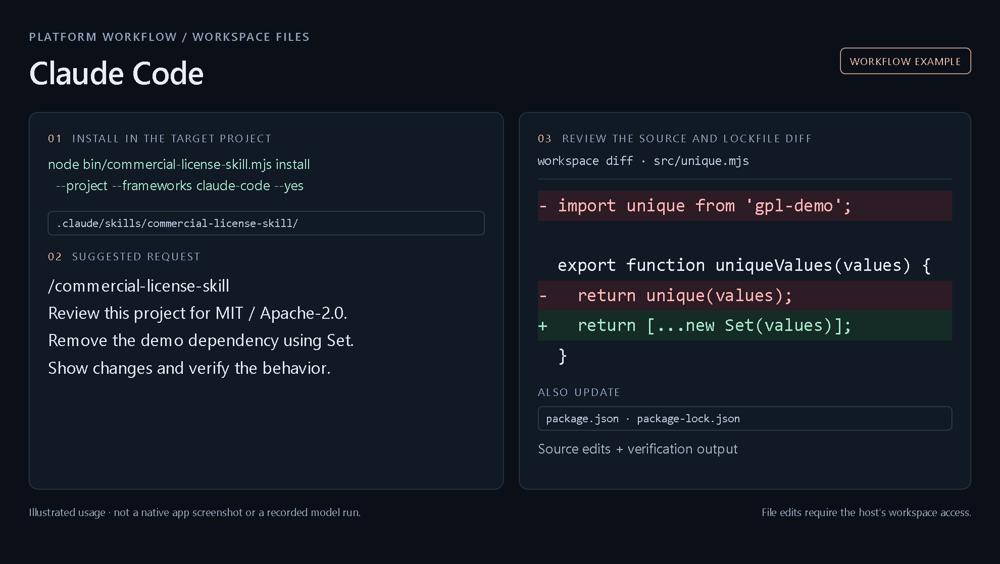](docs/assets/examples/claude-code.png) |

| Antigravity / agy CLI | Gemini CLI |
|---|---|
| [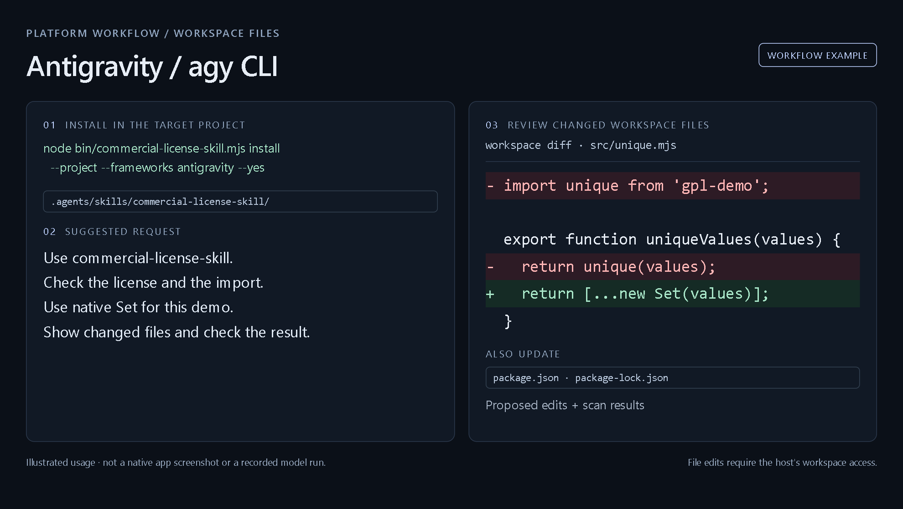](docs/assets/examples/agy.png) | [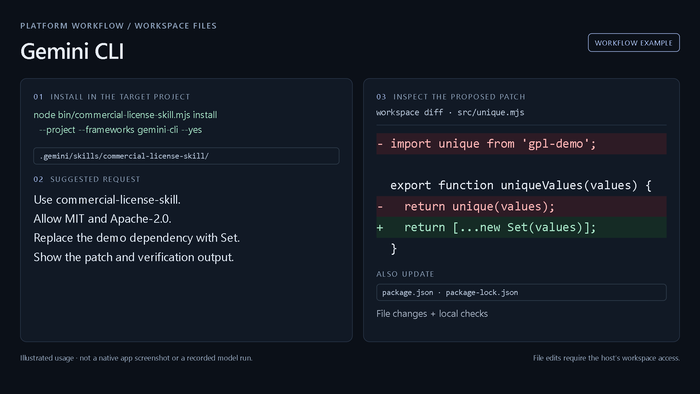](docs/assets/examples/gemini-cli.png) |

| ChatGPT | Claude |
|---|---|
| [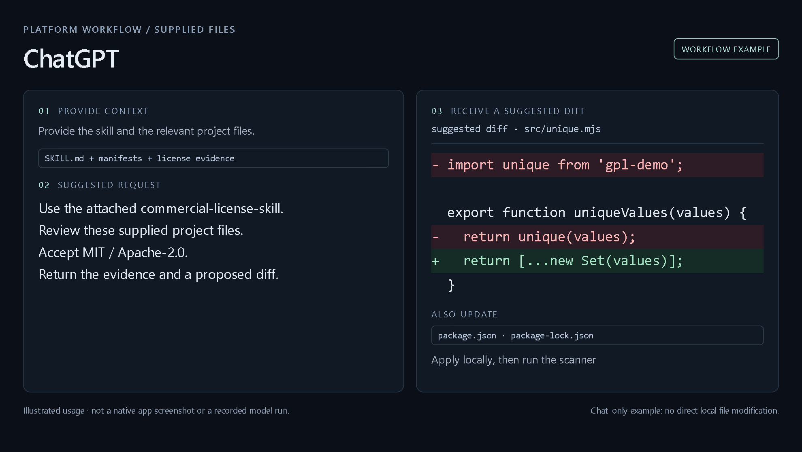](docs/assets/examples/chatgpt.png) | [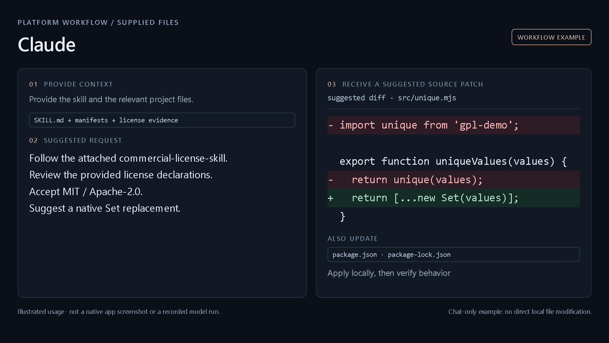](docs/assets/examples/claude.png) |

Copy this request:

```text
Use commercial-license-skill to review this project.
Accept MIT and Apache-2.0; keep our application source private.
Include dependencies, fonts, icons and bundled assets.
Show license evidence, alternatives and API gaps.
Prepare a patch only after checking the selected candidate's exact terms.
```

[Skill instructions](skills/commercial-license-skill/SKILL.md) · [Host paths and setup](skills/commercial-license-skill/references/framework-install-paths.md)

## Find alternatives

```bash
commercial-license-skill recommend imagemagick --allowed-licenses MIT --json
```

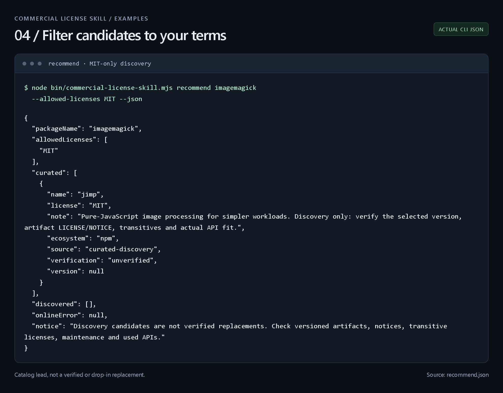

Catalog and npm search results are discovery leads. Verify the selected version, license text, transitive/native dependencies and used APIs before adoption. Add `--online --query "image processing"` for npm discovery.

## Scope

| Local CLI | Agent follow-up |
|---|---|
| npm manifests/v2–v3 locks, local Python metadata, Cargo/Go inventory, vendored license files and executable signals | Exact upstream grants, fonts/icons/images, models/weights/datasets, unsupported locks, built artifacts and replacement compatibility |

> GPL/AGPL can permit commercial use. Source-sharing obligations depend on the actual grant and use. Scans have partial coverage; an `allow` result is not legal clearance.

[CLI options and CI](docs/CLI.md) · [MCP setup](docs/MCP_SETUP.ko.md) · [Security](SECURITY.md) · [Contributing](docs/CONTRIBUTING.md) · [Review record](docs/REVIEW.md) · [Apache-2.0](LICENSE)
